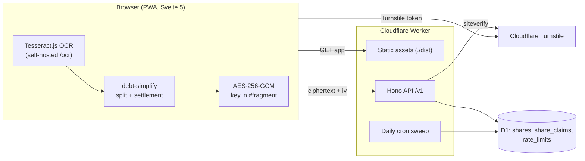

# Tallyup

**Split the bill. Share one link. No app, no sign-up.**

Tallyup is a split-bill and debt-payment PWA:

1. The host adds the people at the table, then scans the receipt or types it in.
2. The host taps who had what and gets a link that "prints" a receipt.
3. Friends open the link, see what they owe and where to transfer, and tap
   **I've paid**.
4. The host confirms each payment until the receipt reads **ALL SETTLED**.

Two things make it different:

- **The server can't read your events.** Everything is encrypted on the
  device (AES-256-GCM), and the key lives only in the link's `#fragment`,
  which browsers never send to a server.
- **Receipt photos never leave the phone.** OCR runs in the browser.

**Documentation:** start at [`PROJECT_BRIEF.md`](PROJECT_BRIEF.md), then
[requirements](docs/01-REQUIREMENTS.md), [architecture](docs/02-ARCHITECTURE.md),
[data model](docs/03-DATA-MODEL.md), [API spec](docs/04-API-SPEC.md),
[security](docs/05-SECURITY.md), [deployment](docs/06-DEPLOYMENT.md),
[roadmap](docs/07-ROADMAP.md).

## Quick start

Requires **Node.js 22+** (Wrangler 4 refuses older).

```bash
npm install
cp .dev.vars.example .dev.vars   # local secrets (Turnstile test key, pass signing key)
npm run db:migrate:local         # create the local D1 schema
npm run dev:api                  # builds the PWA, serves app + API at http://localhost:8787
```

For UI work with hot reload, also run `npm run dev` (Vite on :5173,
proxying `/v1` to :8787).

Locally the Turnstile check uses Cloudflare's always-pass test keys, but its
script still loads from `challenges.cloudflare.com`, so creating an event
needs internet access.

The API under `/v1` serves only the PWA. It is same-origin, sends no CORS
headers and is not a public API.

## How it works

```
phone ─ photo ─► Tesseract (on device) ─► items ─► you tap who had what
      ─ debt-simplify ─► shares, fewest transfers
      ─ AES-256-GCM ─► POST /v1/shares ─► D1 stores ciphertext only

link:  https://…/#/s/<id>/<key>     the key never reaches the server
```

- **Split rules:** a shared item is divided equally among the people who
  had it. Tax, service and discount follow what each person ordered. Every
  bill sums to the exact rupiah.
- **Payments:** a viewer's "I've paid" is an encrypted claim. The host
  confirms it, which records the payment in the event, or declines it. A
  viewer can never clear their own debt.
- **Payment details:** each person can optionally show bank name, account
  number and account holder. The receipt shows only the last four digits.
  The details are deleted once everyone has paid.
- **Bots:** creating an event or claiming a payment needs a client pass. The
  browser gets one by passing a Cloudflare Turnstile check (invisible for
  almost everyone); the pass is HMAC-signed by the Worker and lasts 24 hours.
  Writes are also rate limited, per pass and per IP address.
- **History:** stored on the host's device. The host link (shown once,
  after printing) is the backup.
- **Expiry:** 30 days after the last edit. A daily cron (03:00 UTC) sweeps
  expired events, their claims and old rate-limit windows.

## Architecture

One Cloudflare Worker serves both the built PWA (static assets from
`./dist`) and the Hono API, on the same origin, backed by one D1 database.



API surface (full contract in [`docs/04-API-SPEC.md`](docs/04-API-SPEC.md)):

| Method and path | Guard | Purpose |
|---|---|---|
| `GET /health` | none | Liveness and environment |
| `POST /v1/pass` | rate limit | Exchange a Turnstile token for a 24-hour client pass |
| `POST /v1/shares` | client pass, rate limits | Store a new encrypted event, returns id and edit token |
| `GET /v1/shares/:shareId` | none | Fetch the ciphertext and its pending claims in one response |
| `PUT /v1/shares/:shareId` | edit token, rate limit | Replace the ciphertext; compare-and-swap on `version`, extends expiry |
| `DELETE /v1/shares/:shareId` | edit token, rate limit | Delete the event and its claims |
| `POST /v1/shares/:shareId/claims` | client pass, rate limits | Add an encrypted "I've paid" claim |
| `DELETE /v1/shares/:shareId/claims/:claimId` | edit token, rate limit | Remove a claim once the host has handled it |

Every request goes through secure headers and a 64 KiB body limit. Errors
use one JSON envelope; unexpected errors are logged and returned as a bare
`500`. Security headers for the static PWA (CSP and others) come from
[`web/public/_headers`](web/public/_headers), since asset responses never
pass through Hono.

## Tech stack

Versions are the ranges in `package.json`.

| Area | Choice |
|---|---|
| Runtime and hosting | Cloudflare Workers (free tier), static assets, cron trigger, Wrangler `^4.131.0` |
| Database | Cloudflare D1 (SQLite), Drizzle ORM `^0.45.2`, drizzle-kit `^0.31.10` |
| API | Hono `^4.13.7`, Zod `^4.6.2` |
| Frontend | Svelte `^5.57.1`, Vite `^8.3.2`, service worker + web manifest |
| OCR | Tesseract.js `^7.0.0` with `eng` and `ind` language data, self-hosted |
| Bot protection | Cloudflare Turnstile |
| Other | canvas-confetti `^1.9.4`, TypeScript `^5.9.3` |
| Testing | Vitest `~4.1.11`, `@cloudflare/vitest-pool-workers` `^0.22.0`, Istanbul coverage |

The reasoning, and the free-tier numbers behind it, are in
[`docs/02-ARCHITECTURE.md`](docs/02-ARCHITECTURE.md).

## Layout

```
src/                     Cloudflare Worker: Hono API over D1
  index.ts               app, middleware stack, error envelope, daily sweep
  routes/shares.ts       the /v1/shares endpoints
  routes/pass.ts         Turnstile check -> signed 24-hour client pass
  middleware.ts          rate limits, client-pass and edit-token checks, share loading
  crypto.ts              ids, edit-token hashes, pass signing (no event keys)
  schema.ts              Drizzle schema (source for migrations)
  validation.ts          Zod request schemas
  errors.ts, types.ts    error envelope, bindings and context types
web/                     the PWA (Svelte 5 + Vite)
  src/lib/               crypto, document schema, split math, OCR, parser,
                         API client, client pass, links, local history
  src/views/             Home, Editor (host), Viewer (guest)
  src/components/        Receipt, BillCard, MoneyInput
  public/                manifest, service worker, _headers (CSP), icons
packages/debt-simplify/  split and settlement arithmetic, zero dependencies (npm workspace)
migrations/              D1 SQL migrations generated by drizzle-kit
test/                    API tests (Workers runtime) and test/web (browser logic)
scripts/copy-ocr.mjs     self-hosts Tesseract's worker, WASM and language data
docs/                    requirements, architecture, data model, API, security, deployment, roadmap
.github/                 CI and deploy workflows, Dependabot
```

## Development and testing

```bash
npm run typecheck        # Worker (tsc) + PWA (svelte-check, warnings fail)
npm test                 # API in the Workers runtime + browser logic under Node
npm run test:web         # browser logic only
npm run test:coverage    # with the 80% floor enforced
npm run build            # PWA into ./dist
```

- API tests run inside the real Workers runtime via
  `@cloudflare/vitest-pool-workers`, against a D1 built from the real
  migration files ([`vitest.config.ts`](vitest.config.ts)). Coverage
  (Istanbul) must stay at 80% or above for statements, branches, functions
  and lines.
- Browser logic (split math, receipt parser) runs under plain Node
  ([`vitest.web.config.ts`](vitest.web.config.ts)). Rendering is not
  covered by automated tests; see [`docs/07-ROADMAP.md`](docs/07-ROADMAP.md).
- `predev` and `prebuild` run `scripts/copy-ocr.mjs`, which copies
  Tesseract's files into `web/public/ocr/` (gitignored).

## Database and migrations

D1 holds three tables: `shares` (ciphertext, IV, edit-token hash, version,
timestamps, expiry), `share_claims` (encrypted claims per share) and
`rate_limits`. Details are in [`docs/03-DATA-MODEL.md`](docs/03-DATA-MODEL.md).

```bash
npm run db:generate          # drizzle-kit: generate SQL from src/schema.ts into migrations/
npm run db:migrate:local     # apply to the local D1
npm run db:migrate:remote    # apply to the production D1 (--env production)
```

drizzle-kit only generates SQL; Wrangler applies it. The D1 database is
`tallyup-db`, bound as `DB` in [`wrangler.toml`](wrangler.toml).

## Configuration and secrets

| Name | Kind | Where it is set |
|---|---|---|
| `TURNSTILE_SECRET` | Worker secret | `.dev.vars` locally; `wrangler secret put TURNSTILE_SECRET --env production` |
| `PASS_SECRET` | Worker secret (signs client passes) | `.dev.vars` locally; `wrangler secret put PASS_SECRET --env production` |
| `ENVIRONMENT` | Worker var | `wrangler.toml` `[vars]` / `[env.production.vars]` |
| `DB_SOFT_LIMIT_MB` | Worker var (new events refused above it, default `450`) | `wrangler.toml` |
| `VITE_TURNSTILE_SITE_KEY` | Build-time public sitekey | Shell or CI at build time; falls back to the always-pass test key when unset |
| `CLOUDFLARE_API_TOKEN`, `CLOUDFLARE_ACCOUNT_ID` | GitHub Actions secrets | Repository secrets, used by the deploy workflow |
| `TURNSTILE_SITE_KEY` | GitHub Actions variable | Repository variable, passed to the build as `VITE_TURNSTILE_SITE_KEY` |

`.dev.vars` is gitignored; copy it from
[`.dev.vars.example`](.dev.vars.example). Never put real secrets in
`wrangler.toml` or git. Neither Worker secret can decrypt event data.

## Deployment

Production runs as the `tallyup` Worker under `--env production`. Always
deploy with that environment: both configs share the Worker name, so a bare
`wrangler deploy` overwrites production with `ENVIRONMENT = "development"`.

**Automatic (GitHub Actions).**
[`.github/workflows/ci.yml`](.github/workflows/ci.yml) runs on every pull
request and push to `main` (Node 22): typecheck, build, tests with
coverage, then `npm audit --omit=dev` (report only).
[`.github/workflows/deploy.yml`](.github/workflows/deploy.yml) runs on every
push to `main` and on manual dispatch, in the `production` GitHub
environment. It repeats typecheck and tests, builds with the Turnstile
sitekey, then uses the lockfile-installed Wrangler (`npx wrangler`) to apply
remote D1 migrations and `wrangler deploy --env production`.

**Manual.**

```bash
npm run db:migrate:remote
VITE_TURNSTILE_SITE_KEY=<your-sitekey> npm run deploy   # build + wrangler deploy --env production
```

First-time setup (creating the D1 database and Turnstile widget, setting
secrets), verification, rollback, backups, monitoring and the pre-launch
checklist are in [`docs/06-DEPLOYMENT.md`](docs/06-DEPLOYMENT.md).

## License

MIT (as declared in `package.json`).
